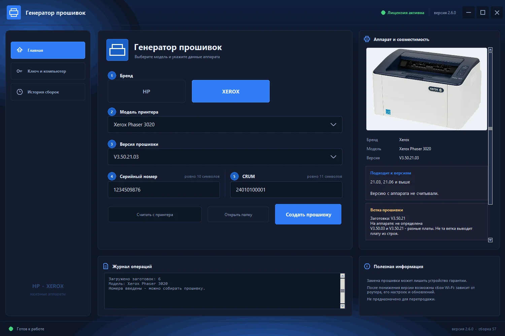

# Генератор прошивок

FIX-прошивка для лазерных принтеров HP и Xerox под серийный номер аппарата.
Подключили принтер по USB — программа сама определит модель, считает
серийник и CRUM, сверит версию и соберёт архив с загрузчиком и инструкцией.

**Сайт:** https://drixed.github.io/hdtool-update/
**Купить ключ и вопросы:** Telegram [@isspaneccxx](https://t.me/isspaneccxx)

## Модели

- Xerox Phaser 3020, WorkCentre 3025BI, WorkCentre 3025NI
- HP Laser 107a / 107r, Laser MFP 135a / 135r / 135w, Laser MFP 137fnw

## Как начать

1. Напишите в Telegram — пришлём программу.
2. Запустите программу, скопируйте код компьютера и отправьте его.
3. Положите полученный `licence.key` рядом с программой.

Windows 7, 10, 11. Устанавливать ничего не нужно.

## Обновления

Программа обновляется сама — при запуске. Если после обновления она не
открывается, напишите в Telegram — поможем.

---

© 2026 Spanniard. HP и Xerox — товарные знаки их владельцев; программа с
ними не связана.
